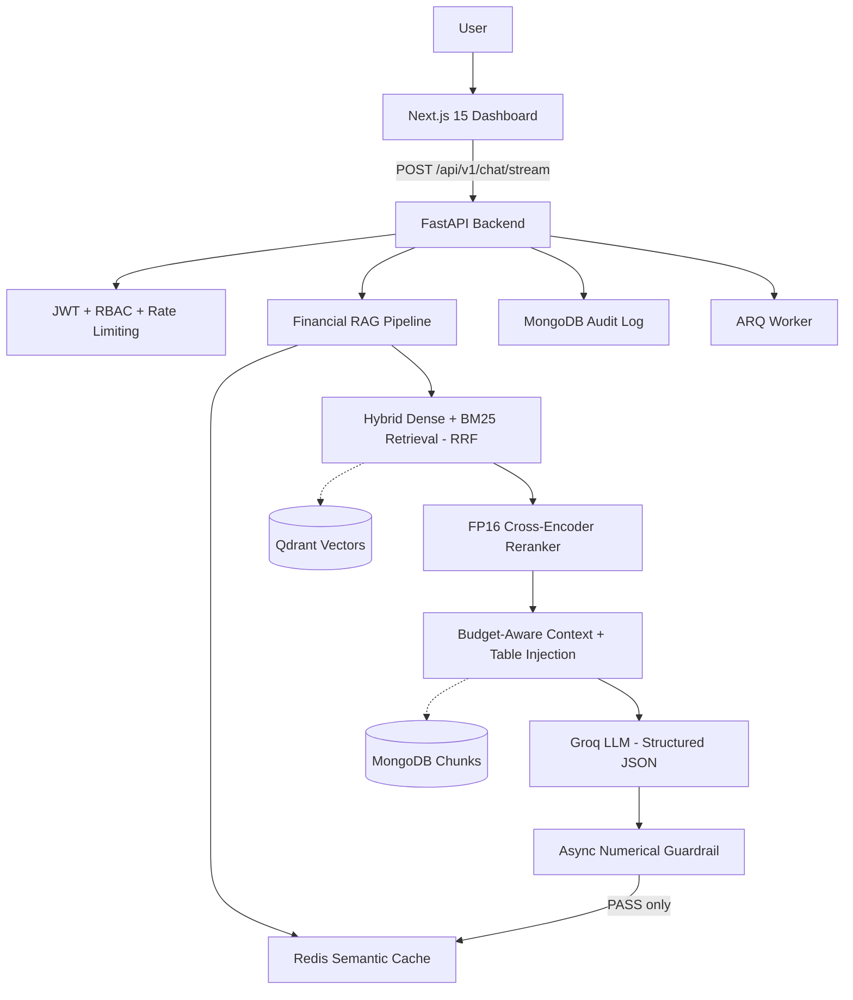

# Financial RAG

**An enterprise-grade Retrieval-Augmented Generation platform for multi-ticker SEC 10-K analysis — engineered so a fluent answer is never a wrong answer.**

Financial RAG ingests real SEC filings, indexes them into a dual document-plus-vector store, and answers grounded financial questions with table-aware hybrid retrieval, cross-encoder reranking, and an automated anti-hallucination guardrail. Every figure that reaches the user is verified against extracted evidence before delivery — and when the evidence isn't there, the platform refuses by design.

---

## The Problem We Solve

Financial filings are the least forgiving documents on earth for a language model. Numbers live inside embedded tables, a single question can hinge on *which fiscal year* is meant, and comparing two companies demands balanced evidence from *each* ticker rather than whichever one matches the query best. In this domain, a fluent but incorrect revenue figure is more dangerous than no answer at all.

Financial RAG is built around that reality:

- **Embedded tables are retrieved as first-class evidence** — not flattened away and lost.
- **Fiscal-year reasoning is explicit** — questions resolve against the correct period, not a nearby one.
- **Multi-ticker comparisons stay balanced** — no single company dominates the evidence set.
- **Numerical correctness is enforced, not hoped for** — an asynchronous guardrail verifies claims against extracted data.
- **Refusal is a first-class outcome** — out-of-scope questions return an explicit, structured refusal instead of fabricated figures.

The system treats a verified number and an honest refusal as equally acceptable outcomes. Everything below exists to serve that invariant.

---

## Platform Architecture

The platform ships as a **Docker Compose stack of six core services**, with a Redis-backed **ARQ** worker for asynchronous, high-concurrency workloads.

| Service | Technology | Responsibility |
|:--|:--|:--|
| **Backend API** | FastAPI (Python 3.12) | Auth, RBAC, dynamic rate limiting, audit logging, SSE streaming, session memory, analytics, ingestion orchestration |
| **Frontend** | Next.js 15 (App Router) | Dashboard: authentication, streaming chat, document upload, system analytics |
| **Document Store** | MongoDB 7 | Authoritative raw chunks, users, and audit records |
| **Vector Store** | Qdrant | 768-dimensional cosine vectors, HNSW index, lightweight metadata payloads |
| **Cache & Broker** | Redis 7 | Semantic answer cache, rate-limit buckets, token-revocation blacklist, ARQ broker |
| **Model Registry** | MLflow | Experiment tracking and model registry with `Staging` / `Production` aliases |
| **Async Worker** | ARQ (Redis-backed) | Background ingestion, heavy processing, and scheduled tasks so the API stays responsive |

An optional Streamlit operator console is included for live demonstrations.

### Request Lifecycle



The pipeline itself is **stateless**; conversational context is managed deliberately at the API layer, keeping every pipeline stage independently testable and horizontally scalable.

---

## The Intelligent Request Pipeline

Every question flows through a deterministic, multi-stage lifecycle. Each stage exists to raise precision, control cost, or enforce correctness.

1. **Session Restoration** — the caller's conversation memory is restored and fiscal-year references are normalized before any retrieval begins.
2. **Semantic Caching** — a Redis-backed cache short-circuits previously answered questions. Entries are replayable only when their prior guardrail verdict passed.
3. **Hybrid Retrieval** — dense vector search (Qdrant ANN) and sparse lexical search (BM25) run in parallel and are fused with **Reciprocal Rank Fusion** (`k=60`), combining semantic understanding with exact-token precision.
4. **Cross-Encoder Reranking** — a **FP16 cross-encoder** (`bge-reranker-large`) rescores the fused candidates, compressing 40 documents down to the 8 that will actually reach the model. A FP32 CPU path is available as a fallback.
5. **Budget-Aware Context Assembly** — a table shield validates tabular chunks, a cylinder reorder distributes sources so no filing dominates, and query-grounded **table injection** restores real numbers under a shared character budget.
6. **Structured Generation** — Groq-hosted models (`gpt-oss-120b`, with a `gpt-oss-20b` fallback) produce a schema-validated JSON answer with citations, deterministic decoding, and an explicit retry ladder.
7. **Async Numerical Guardrail** — every numerical claim is verified against the model's extracted evidence; only verified responses are cached, and the verdict propagates to the response, the audit log, and the analytics layer.

---

## Numerical Safety & Guardrails (D1–D8)

The guardrail subsystem is the platform's defining engineering achievement: a set of eight tracked defect-and-capability controls (D1–D8) that close the gap between *plausible* and *provable*.

| ID | Capability | Resolution |
|:--|:--|:--|
| **D1** | Guardrail verdict was computed then discarded | Real verdict (`passed` / `failed` / `error` / `not_run`) propagated end-to-end into the API response, audit log, and cache gate |
| **D1b** | Cache served entries without enforcing their verdict | Cache hits ignored unless the stored `guardrail_passed` flag is explicitly true |
| **D2** | Guardrail pass rate divided by ineligible events | Rate computed over eligible events only; eligible count exposed for transparency |
| **D3** | Latency measured with a non-monotonic wall clock | Switched to a monotonic high-resolution clock; outliers surfaced rather than hidden |
| **D4** | Context-quality buckets degenerated to a single value | Score normalization with tertile thresholds for a meaningful distribution |
| **D5** | Refusals detectable only via structured-output failure | First-class refusal schema with a dedicated refusal model and explicit output classification |
| **D6** | MongoDB ↔ Qdrant drift with no visibility or safe tooling | Health-reported store parity plus scoped safe-replacement and identity-reconciliation tooling |
| **D7** | Demo-script correctness | Corrected labels and step numbering across operational walkthroughs |
| **D8** | Year-token false positives flagged correct answers as failures | Trailing-punctuation normalization so a standalone year token compares equal to the same year in evidence — eliminating spurious `failed` verdicts on correct answers |

Together these controls make the guardrail a **closed loop**: it cannot pass silently, cannot be bypassed by the cache, and cannot accuse a correct answer.

---

## Evaluation & Benchmark Results

The platform has passed its automated quality gate and is approved for production deployment. The benchmark set is 25 curated, ground-truth financial questions scored by an independent LLM judge, with every metric clearing its production threshold.

| Metric | Score | Threshold | Status |
|:--|:--:|:--:|:--:|
| **Faithfulness** | **0.990** | ≥ 0.85 | ✅ Pass |
| **Answer Relevance** | **0.920** | ≥ 0.80 | ✅ Pass |
| **Context Precision** | **0.845** | ≥ 0.75 | ✅ Pass |
| **Context Recall** | **0.847** | ≥ 0.80 | ✅ Pass |

**Quality gate: PASSED** — registered as the `@Production` model alias. Faithfulness above 0.99 means the system is, in practice, answering only from evidence it can support.

---

## Engineering Excellence

### Test Suite

The platform is validated by a **full test suite spanning 600+ test functions**, covering every retrieval stage, the generation and streaming paths, the guardrail enforcement logic, the complete API surface, RBAC, rate limiting, cache behavior, and ingestion identity/reconciliation. Ingestion re-processing, store parity, and guardrail verdict propagation are all covered by dedicated regression tests — including explicit regression coverage for the D8 year-token fix.

### Enterprise Features

- **Authentication & RBAC** — JWT (HS256) access tokens with refresh flow, bcrypt password hashing, and Redis-backed token revocation. Administrative actions are gated server-side: document upload, ingestion, cache deletion, and database clearing all require the admin role and return **HTTP 403** otherwise.
- **Dynamic Rate Limiting** — per-identity buckets (`user:<id>` for authenticated callers, `ip:<host>` otherwise) with structured `429` responses, so a single client cannot exhaust shared capacity.
- **Audit Logging** — every request is recorded to MongoDB with its query, retrieved context, prompt, response, latency, model, cache status, and guardrail verdict — a complete, queryable provenance trail.
- **Word-Granular SSE Streaming** — responses stream incrementally with word-level granularity, so the UI never renders a partial token, while citations and guardrail status arrive with the completed object.
- **Resilient by Default** — guarded fallbacks across the LLM, reranker, cache, MLflow, and datastore layers mean a dependency outage degrades gracefully rather than failing the request.

### Scalable Ingestion

Documents are parsed (LlamaParse for PDF/DOCX with native fallbacks), cleaned with financial-safe normalization, chunked with deterministic content-addressed identifiers, embedded on GPU, and written to both stores idempotently — re-ingesting a filing updates records in place instead of duplicating them. Heavy ingestion runs on the **ARQ worker**, keeping the interactive API non-blocking.

---

## Quickstart

**1. Configure the environment**

```bash
cp .env.example .env
```

Then set the required values in `.env`:

```bash
GROQ_API_KEY=your-groq-api-key
LLAMA_CLOUD_API_KEY=your-llama-cloud-key   # optional, enables PDF/DOCX parsing
JWT_SECRET_KEY=a-long-random-secret
SUPERADMIN_EMAIL=admin@financial-rag.local
SUPERADMIN_PASSWORD=a-strong-password
```

**2. Launch the stack**

```bash
docker compose up -d --build
```

**3. Open the services**

| Service | URL |
|:--|:--|
| Frontend dashboard | `http://localhost:3000` |
| Backend API & OpenAPI docs | `http://localhost:8000/docs` |
| Health & store parity | `http://localhost:8000/health` |

**4. Sign in** with the superadmin credentials from your `.env`, upload a filing, and start asking grounded questions.

---

## Project Structure

```
Financial_RAG/
├── app/api/            FastAPI backend — endpoints, session memory, SSE streaming,
│                       upload, audit, analytics, RBAC, rate limiting, ARQ worker
├── src/
│   ├── pipeline.py     RAG orchestrator — fiscal-year reasoning, multi-ticker balancing
│   ├── model_loader.py Three-tier pipeline loader (cache → registry → direct)
│   ├── 1_ingestion/    Parse → clean → metadata → chunk → dual-store index
│   ├── 2_caching/      Redis client and multi-tier semantic cache
│   ├── 3_pre_retrieval/ Intent routing and query expansion
│   ├── 4_retrieval/    Hybrid search → reranker → post-retrieval → table shield
│   └── 5_generation/   Generator → async guardrail → schemas → streaming
├── config/             Environment-driven settings and structured JSON logging
├── evaluation/         Synthetic dataset → batch runner → LLM judge → quality gate
├── frontend/           Next.js 15 dashboard (auth, chat, upload, analytics)
├── test/               Comprehensive unit, integration, and live test suite
├── docker-compose.yml  Six-service containerized stack plus ARQ worker
```

---

## Technology Stack

| Layer | Technologies |
|:--|:--|
| **Backend** | FastAPI · Python 3.12 · Pydantic · Slowapi · PyJWT · bcrypt |
| **Retrieval & ML** | Qdrant · `nomic-embed-text-v1.5` (768-d) · BM25 · `bge-reranker-large` (FP16) |
| **Generation** | Groq (`gpt-oss-120b` / `gpt-oss-20b`) with structured JSON output |
| **Data & Messaging** | MongoDB 7 · Redis 7 · ARQ (async worker) |
| **Frontend** | Next.js 15 · React · Tailwind CSS · SSE streaming client |
| **MLOps** | MLflow tracking and model registry |
| **Parsing** | LlamaParse · pypdf · python-docx · custom HTML/SGML parsers |

---

## Documentation Map

- **PROJECT_MAP.md** — the authoritative, code-verified architecture reference.
- **docs/CUTOVER_REPORT.md** — final acceptance report covering the D1–D7 control set.
- **docs/DEMO_SCRIPT.md** — live demonstration scenarios.
- **test_artifacts/TEST_RUN_REPORT.md** — full test-suite evidence and raw logs.
- **artifacts/EVALUATION_SUMMARY.md** — evaluation scores and production gate results.

---

## Author

**Youssef** — AI Engineering · RAG Systems · Data Science

*Financial RAG is engineered on a single principle: trust is earned by verification, not fluency.*
